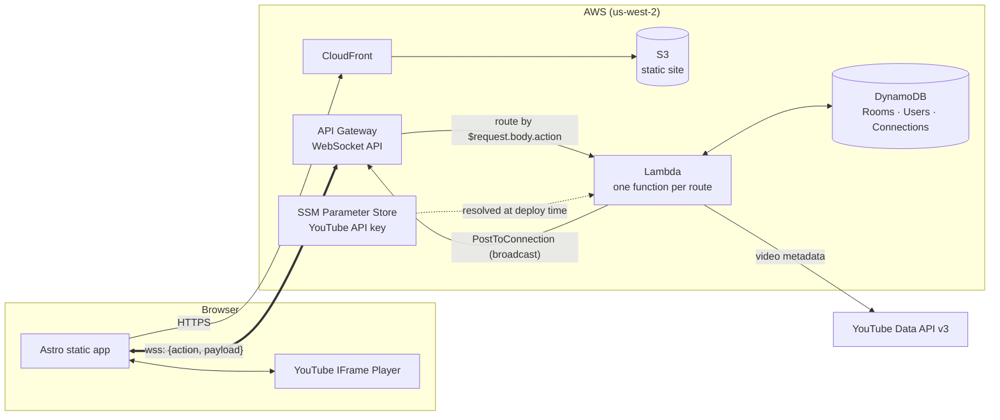
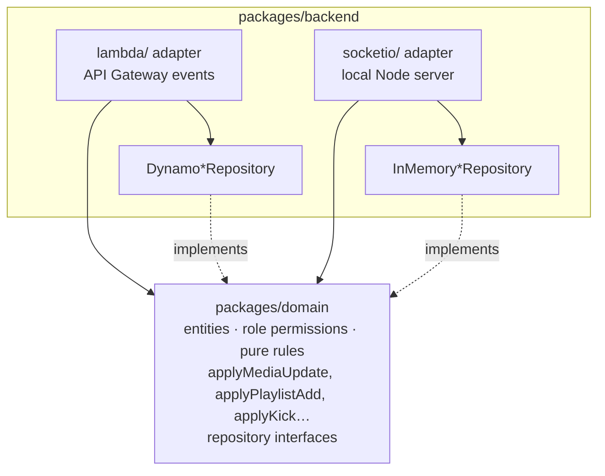

# smol-tube

A serverless watch party: people in the same room watch a YouTube video in sync, chat, and share a play queue. The backend runs on AWS API Gateway WebSockets, Lambda and DynamoDB, so nothing is running (or billing for compute) while the room is empty.

**Live:** <https://tube.smol-ivan.xyz/> — a personal test deployment (see [Status](#status)).

## Why this exists

During the pandemic I spent a lot of time in an online community that ran an always-on watch party room: a synced YouTube/Twitch player, a chat full of community-made emotes, a shared queue with history, role-based queue management, skip votes and quick polls. That room ran on [CyTube](https://github.com/calzoneman/sync). Back then I knew nothing about networking or software, and I couldn't figure out how to host it myself.

Years later, studying computer engineering, I came back to that idea as an excuse to learn what I'm interested in: cloud infrastructure and delivery. Instead of self-hosting CyTube, which is built around a long-running Node server, I rebuilt the core from scratch with one deliberate constraint: **it had to be serverless on AWS**, deployed through CI/CD.

## Architecture



- **One Lambda per WebSocket route** (`$connect`, `$disconnect`, `joinRoom`, `chatMsg`, `mediaUpdate`, `becomeLeader`, `playlistAdd/Remove/Reorder/Play`, `transitionNext`), all defined in [`template.yml`](template.yml) (AWS SAM).
- **Broadcast** queries the `Connections` table by its `RoomIndex` GSI and pushes to each connection through the API Gateway Management API. Stale connections (`410 Gone`) are removed on the way.
- **A room is a single DynamoDB item.** Every handler loads it, applies a domain rule, and writes it back whole.
- **The frontend** is a static Astro build served from S3 behind CloudFront. The bucket is private and only reachable through CloudFront (OAC). The bucket, the distribution, its certificate, the DNS records (Namecheap) and the SSM parameter were created by hand and are not in IaC yet (see [Roadmap](#known-limitations-and-roadmap)).

### One domain, two adapters



I wanted a fast local loop without duplicating the business logic between local development and AWS. The rules live in `packages/domain`: plain TypeScript functions such as `applyX(room, request) → Room | null` that have no I/O and don't depend on Socket.IO or the AWS SDK. The repository interfaces live there too. Each runtime is a thin adapter that loads state, calls the rule, saves the result and broadcasts it. The domain is bundled into every Lambda with esbuild.

### Playback sync

Sync follows CyTube's model: **a single leader per room** owns the playback state, and everyone else follows it. The leader's player reports play, pause and seek events, plus a heartbeat every 5 s while playing. Followers apply the state they receive and only seek when they drift too far (more than 15 s, or on a play/pause change). Most of the work here was getting the YouTube IFrame API to behave: player readiness, the iframe replacing its mount node, and recreating the player when control changes hands.

## Features

| Feature                                 | Domain rule | Local (Socket.IO) | AWS (Lambda) | UI  |
| --------------------------------------- | :---------: | :---------------: | :----------: | :-: |
| Join room, presence list                |      —      |        ✅         |     ✅ ¹     | ✅  |
| Chat                                    |     ✅      |        ✅         |      ✅      | ✅  |
| Synced YouTube playback, leader handoff |     ✅      |        ✅         |      ✅      | ✅  |
| Queue: add / remove / reorder / play    |     ✅      |        ✅         |      ✅      | ✅  |
| Play history (last 3)                   |     ✅      |        ✅         |      ✅      | ✅  |
| Skip vote                               |     ✅      |        ✅         |      ❌      | ✅  |
| Kick / ban / unban                      |     ✅      |        ✅         |      ❌      | ❌  |
| Grant / revoke moderator                |     ✅      |        ✅         |      ❌      | ❌  |
| Accounts with passwords                 |      —      |      mock ²       |    mock ²    | ✅  |

¹ Users who leave are not removed from the list. See [limitations](#known-limitations-and-roadmap).
² Not real authentication. See [Status](#status).

## Stack

| Area      | Tech                                                                                                        |
| --------- | ----------------------------------------------------------------------------------------------------------- |
| Backend   | AWS API Gateway (WebSocket), Lambda (Node.js 20, esbuild bundles), DynamoDB (on-demand, GSI), SSM           |
| IaC       | AWS SAM ([`template.yml`](template.yml), [`samconfig.toml`](samconfig.toml))                                |
| Frontend  | Astro + TypeScript + Tailwind, no component framework, YouTube IFrame API; S3 + CloudFront                  |
| Local dev | Node + Express + Socket.IO with in-memory repositories; Nix flake + direnv                                  |
| Tooling   | pnpm workspaces, Prettier, `tsc` / `astro check`, Vitest                                                    |
| CI/CD     | GitHub Actions: checks on every PR to `main`, path-filtered deploys of backend (SAM) and frontend (S3 sync) |

## Repository layout

```
packages/
  domain/      pure business rules, entities, repository interfaces (+ tests)
  backend/
    lambda/        API Gateway handlers, broadcast helper, shared context
    socketio/      local Socket.IO server
    repositories/  DynamoDB and in-memory implementations
    scripts/       esbuild bundling, one bundle per Lambda
  frontend/    Astro app (UI, WebSocket client, YouTube player sync)
template.yml   SAM template: tables, WebSocket API, routes, functions, IAM
.github/workflows/
  integration.yml      PR checks
  deploy-backend.yml   sam build && sam deploy on push to main
  deploy-frontend.yml  astro build → s3 sync → CloudFront invalidation
  pr-agent.yml         AI-generated PR descriptions
```

## Running it

### Environment

With Nix (flakes) and direnv:

```sh
direnv allow        # or: nix develop
```

This gives you Node.js 24 and pnpm from [`flake.nix`](flake.nix). Without Nix, use Node.js ≥ 22.12 and pnpm 10.

```sh
pnpm install
cp .env.example .env   # then fill in the values
```

### Checks and build

```sh
pnpm lint        # prettier --check + typecheck, per package
pnpm test        # domain unit tests (Vitest) + astro check
pnpm build       # Astro static build + one esbuild bundle per Lambda
```

### Local development

```sh
pnpm dev:back    # Socket.IO server on :3000, in-memory state, seeded accounts from SEED_USERS_JSON
pnpm dev:front   # Astro dev server; needs PUBLIC_SOCKET_URL
```

> **Heads-up:** since the switch to API Gateway, the frontend uses a native WebSocket client (`{action, payload}` JSON envelope) and no longer speaks the Socket.IO protocol. In practice `pnpm dev:front` currently works against the **deployed** WebSocket API, not against the local server. Replacing the Socket.IO server with a local runner for the Lambda handlers is on the roadmap.

### Deploying

Deploys are automatic when a change is merged to `main`:

- **Backend:** builds the Lambda bundles, then runs `sam build` and `sam deploy` (stack `smol-tube-backend`, `us-west-2`).
- **Frontend:** runs `astro build` with the WebSocket URL, then `aws s3 sync --delete` and a CloudFront invalidation.

One-time manual setup outside the repo:

- Private S3 bucket + CloudFront distribution with OAC, an ACM certificate in `us-east-1`, and DNS records in Namecheap for `tube.smol-ivan.xyz` (see [infrastructure](docs/infrastructure.md#frontend-hosting))
- SSM parameter `/smol-tube/youtube-api-key`
- IAM user for GitHub Actions. <!-- TODO: document the attached permissions -->
- GitHub secrets: `AWS_ACCESS_KEY_ID`, `AWS_SECRET_ACCESS_KEY`, `GEMINI_API_KEY` (PR agent)

## Documentation

Deeper write-ups live in [`docs/`](docs/README.md): [architecture](docs/architecture.md), [playback sync](docs/playback-sync.md), [infrastructure](docs/infrastructure.md), [CI/CD](docs/ci-cd.md) and [local development](docs/local-development.md). The reasons behind the main choices are in the [architecture decision records](docs/adr/README.md).

## Status

Live and working end to end for its core flow: join, chat, synced playback and the queue. **This is a personal test deployment with a single user (me)**, not a public service, and I left it in this state on purpose for now. Because of that, some shortcuts are still in place. The most important one is that the AWS `joinRoom` handler accepts a hardcoded admin password, so treat accounts and roles as a mock. Users get created again on every join.

## Known limitations and roadmap

**Planned next**

1. **Keep developing locally, then promote to production.** Finish the features that exist only in the domain or the local server (skip votes, moderation, roles) and bring them to the Lambda adapter.
2. **Develop locally against the real handlers.** Replace the Socket.IO server with a small native-WebSocket server that wraps each message in an API Gateway-shaped event and calls the same Lambda handlers, with in-memory (or DynamoDB Local) repositories. That leaves a single backend adapter, so features built locally run unchanged on AWS.
3. **Everything as code.** Move S3, CloudFront, DNS, the SSM parameter and CI credentials into IaC, and stop doing manual console steps.

**Known limitations**

- **Auth:** the admin password is hardcoded in the Lambda handler, and there's no authorizer on `$connect`.
- **Guest leaders:** guests can take the lead, but the domain requires `playback:control` (moderator and admin only) to accept a `mediaUpdate`. A guest leader's play, pause and seek are rejected.
- **Concurrency:** a room is read, modified and rewritten whole, without a conditional write, so two concurrent updates can overwrite each other. Planned fix: optimistic locking with a version attribute.
- **TTL:** TTL is enabled on all tables, but `expiresAt` is never set, so nothing expires yet.
- **Disconnects:** the `$disconnect` handler doesn't notify the room in the format the client expects, so the user list keeps people who left.
- **Skip vote:** there's no `skipVote` route in AWS yet. The client also fakes success acknowledgements, so errors are not shown.
- **Heartbeat traffic:** in AWS, every leader heartbeat (every 5 s) triggers a DynamoDB write and a broadcast to the whole room. The local server only broadcasts real state changes.
- **No reconnection:** API Gateway closes WebSocket connections after at most 2 h, and the client doesn't reconnect on its own.
- **CI/CD:**
    - The backend deploy's path filter doesn't include `packages/domain/**`, and it names `template.yaml` instead of `template.yml`.
    - The PR workflow runs `format:write` before linting, so formatting is never enforced.
    - Deploys use long-lived IAM keys instead of OIDC.
    - The pnpm and Node versions aren't aligned between the workflows and the repo.
- **Runtime:** Lambda runs on `nodejs20.x`, which is past end of life, so it needs an upgrade.
- **IAM:** every function gets CRUD access to all three tables, which is broader than least privilege.
- **Tests:** only the moderation rules have unit tests. Playback rules and the adapters have none.
