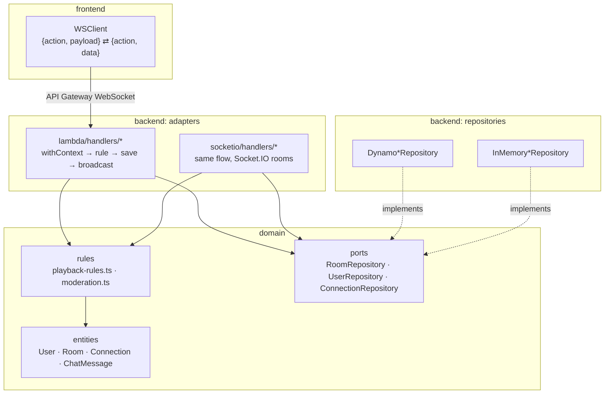
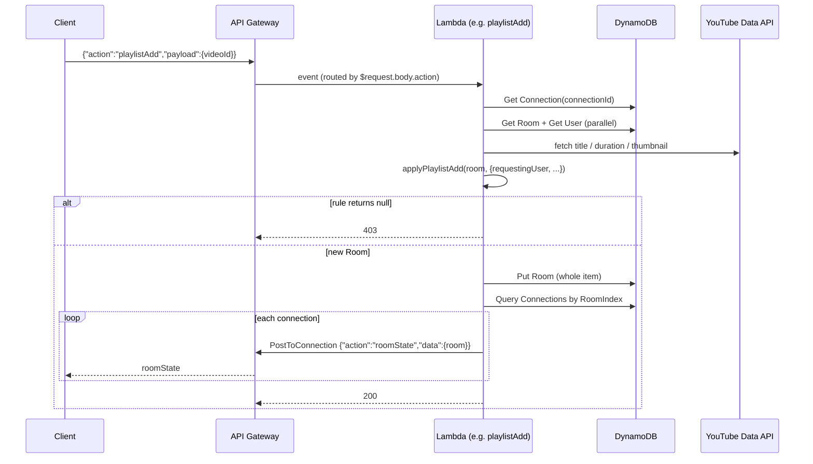

# Architecture

smol-tube is a pnpm monorepo with three packages:

| Package             | Role                                                                                           |
| ------------------- | ---------------------------------------------------------------------------------------------- |
| `packages/domain`   | Entities, role permissions, pure business rules, repository interfaces. No I/O, no framework.  |
| `packages/backend`  | Adapters that run the domain: AWS Lambda handlers (production) and a Socket.IO server (local). |
| `packages/frontend` | Static Astro app: UI, native WebSocket client, YouTube player sync.                            |

## Layers



Dependencies point inward. `domain` imports nothing from `backend` or `frontend`. The Lambda handlers only know the repository interfaces, and `lambda/state.ts` is the one place that wires the DynamoDB implementations in.

## Domain model

| Entity          | What it represents                                                                                                                            |
| --------------- | --------------------------------------------------------------------------------------------------------------------------------------------- |
| `User`          | An identity (`userId`, `displayName`, `role`), separate from any socket. A user can reconnect without becoming someone else.                  |
| `Connection`    | One physical WebSocket (`connectionId`) linked to a `userId` and a `roomId`. It can disappear (closed tab, kick) while the user still exists. |
| `Room`          | The whole shared state: `playback` (video, time, paused, leader), `playlist`, `history` (last 3), `skipVotes`, `bans`.                        |
| `PlaybackState` | `videoId`, `currentTime`, `paused`, `leaderUserId`.                                                                                           |
| `BanEntry`      | A ban on an identity (`userId`), not on a connection, so reconnecting does not get around it.                                                 |
| `ChatMessage`   | Sender, text and timestamp. Messages are validated (1–320 chars), broadcast, and **never stored**.                                            |

### Roles and permissions

Each role gets an explicit list of permissions instead of a computed hierarchy, so you can see what each role can do at a glance ([`domain/user.ts`](../packages/domain/user.ts)).

| Permission                                                | guest | moderator | admin |
| --------------------------------------------------------- | :---: | :-------: | :---: |
| `chat:send`                                               |  ✅   |    ✅     |  ✅   |
| `playback:becomeLeader`                                   |  ✅   |    ✅     |  ✅   |
| `playback:control`                                        |       |    ✅     |  ✅   |
| `playlist:add` / `playlist:remove` / `playlist:reorder`   |       |    ✅     |  ✅   |
| `moderation:kick` / `moderation:ban` / `moderation:unban` |       |    ✅     |  ✅   |
| `roles:grantModerator` / `roles:revokeModerator`          |       |           |  ✅   |

### Rules are pure functions

Every rule has the same shape:

```ts
applyX(room: Room, request: { requestingUser: User; ... }): Room | null
```

A rule returns a **new** `Room`, or `null` when the request is not allowed. It never mutates its input; the tests check this explicitly. Because the rules don't touch I/O, they can be unit-tested without mocks, and both adapters reuse them unchanged.

## Request lifecycle (AWS)

Every route except `$connect`, `$disconnect` and `joinRoom` goes through the same wrapper, [`lambda/utils/withContext.ts`](../packages/backend/lambda/utils/withContext.ts):



Notes:

- Handlers return HTTP-like status codes, but API Gateway doesn't send those back to the client on custom routes. The client only learns what happened through broadcasts, so a rejected action is silent.
- A broadcast that gets `410 Gone` deletes that stale connection on the way.

### Joining a room

`joinRoom` creates the room the first time someone joins it. It creates a `User`, saves the `Connection`, sends `joinRoomSuccess` (room, user, connected users) to the caller, and broadcasts `presenceChanged` to the room.

## Event contract

Client → server: `{ "action": <name>, "payload": {...} }`. Server → client: `{ "action": <name>, "data": {...} }`.

| Client action                                                   | Payload                              | AWS route | Local (Socket.IO) |
| --------------------------------------------------------------- | ------------------------------------ | :-------: | :---------------: |
| `joinRoom`                                                      | `roomId`, `displayName`, `password?` |    ✅     |        ✅         |
| `chatMsg`                                                       | `text`                               |    ✅     |        ✅         |
| `becomeLeader`                                                  | —                                    |    ✅     |        ✅         |
| `mediaUpdate`                                                   | `videoId`, `currentTime`, `paused`   |    ✅     |        ✅         |
| `playlistAdd`                                                   | `videoId`, `atTop?`                  |    ✅     |        ✅         |
| `playlistRemove`                                                | `itemId`                             |    ✅     |        ✅         |
| `playlistReorder`                                               | `fromIndex`, `toIndex`               |    ✅     |        ✅         |
| `playlistPlay`                                                  | `itemId`                             |    ✅     |        ✅         |
| `transitionNext`                                                | —                                    |    ✅     |        ✅         |
| `skipVote`                                                      | —                                    |    ❌     |        ✅         |
| `kick` / `ban` / `unban` / `grantModerator` / `revokeModerator` | `targetUserId`                       |    ❌     |        ✅         |

| Server event      | Data                                 | Sent by                             |
| ----------------- | ------------------------------------ | ----------------------------------- |
| `joinRoomSuccess` | `room`, `user`, `connectedUsers`     | `joinRoom` (to the caller only)     |
| `presenceChanged` | `userId`, `displayName`, `connected` | join; leave (local only)            |
| `roomState`       | `room`                               | every action that changes the room  |
| `chatMsg`         | `ChatMessage`                        | `chatMsg`                           |
| `userRoleUpdated` | `userId`, `role`                     | grant/revoke moderator (local only) |

## Storage (DynamoDB)

| Table         | Key            | Contents                             | Access pattern                                                         |
| ------------- | -------------- | ------------------------------------ | ---------------------------------------------------------------------- |
| `Rooms`       | `roomId`       | `data`: the whole `Room` as one item | get / put the whole room                                               |
| `Users`       | `userId`       | the `User`                           | get by id                                                              |
| `Connections` | `connectionId` | the `Connection`                     | get by id; **GSI `RoomIndex`** (`roomId`) to list a room for broadcast |

All tables are on-demand and have TTL enabled on `expiresAt` (not populated yet; see the README's limitations).

**Why a room is one item:** sync needs a single source of truth, and the scale this project targets doesn't call for anything more complex. Each write replaces the whole room. A single `PutItem` is atomic, but the read → apply rule → write cycle is not isolated: two concurrent Lambdas can overwrite each other's change (a lost update). The planned fix is optimistic locking with a `version` attribute and a `ConditionExpression`. One item also caps a room at DynamoDB's 400 KB item limit, which is far above what a queue of a few dozen videos needs.

## Two adapters, today

Both adapters follow the same pattern (load context → rule → save → notify), but they have drifted apart:

- The Socket.IO adapter implements moderation, roles and skip votes. It also skips broadcasting pure heartbeats.
- Since the frontend moved to a native WebSocket client, it can't talk to the Socket.IO server any more.

The roadmap replaces the Socket.IO adapter with a local runner that feeds API Gateway-shaped events to the **Lambda handlers themselves**, leaving one adapter for both environments.
