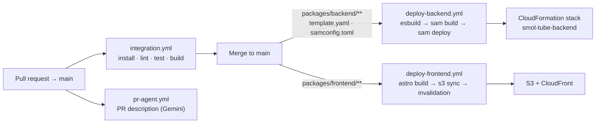

# CI/CD

All automation is GitHub Actions, in [`.github/workflows/`](../.github/workflows). Pull requests to `main` get checks and an AI-written description. Merging to `main` deploys whichever side changed.

## Workflows

### `integration.yml`: checks on every PR

Runs on `pull_request` to `main`, with `permissions: contents: read`.

1. pnpm `10.28.1` (matches `packageManager`), Node.js `22.12.0` (the frontend's minimum).
2. `pnpm install --frozen-lockfile`.
3. `pnpm format:write`, then `pnpm lint`, which is Prettier `--check` plus `tsc --noEmit` / `astro check` for the root and every package.
4. `pnpm test`: Vitest for the domain, `astro check` for the frontend.
5. `pnpm build`: the Astro static build and the eleven Lambda bundles.

Because step 3 writes the formatting before checking it, the lint step never fails on formatting. Replacing `format:write` with nothing (lint already runs `--check`) would enforce it.

### `deploy-backend.yml`: SAM deploy

Runs on `push` to `main` when `packages/backend/**`, `template.yaml` or `samconfig.toml` change.

1. pnpm 9, Node.js 22, `aws-actions/setup-sam@v2`.
2. AWS credentials from the `AWS_ACCESS_KEY_ID` / `AWS_SECRET_ACCESS_KEY` secrets (`us-west-2`).
3. `pnpm install`, then `pnpm --filter @smol-tube/backend build` (esbuild, see [infrastructure](infrastructure.md#packaging)).
4. `sam build`, then `sam deploy --no-confirm-changeset --no-fail-on-empty-changeset`. `samconfig.toml` sets `confirm_changeset = true` for interactive use, and the flag turns that off in CI. The second flag lets a run with no infrastructure changes succeed.

### `deploy-frontend.yml`: static site

Runs on `push` to `main` when `packages/frontend/**` changes.

1. Same toolchain and credentials as the backend deploy.
2. `astro build` with `PUBLIC_SOCKET_URL` set to the production `wss://` URL. Astro inlines `PUBLIC_*` variables at build time, so the URL is part of the static bundle.
3. `aws s3 sync packages/frontend/dist s3://<bucket> --delete`, which also removes files that no longer exist in the build.
4. `aws cloudfront create-invalidation --paths "/*"`, so the new build is served right away instead of after the cache expires.

### `pr-agent.yml`: PR descriptions

Runs [PR-Agent](https://github.com/the-pr-agent/pr-agent) with Gemini (`GEMINI_API_KEY` secret) on opened, reopened and ready-for-review PRs. It only writes the description: `auto_review` and `auto_improve` are off. It also listens to `issue_comment`, so PR-Agent commands in a PR comment work.

## Secrets

| Secret                                        | Used by                  |
| --------------------------------------------- | ------------------------ |
| `AWS_ACCESS_KEY_ID` / `AWS_SECRET_ACCESS_KEY` | Both deploy workflows    |
| `GEMINI_API_KEY`                              | `pr-agent.yml`           |
| `GITHUB_TOKEN` (automatic)                    | `pr-agent.yml` (comment) |

The YouTube API key is not a GitHub secret. It stays in SSM and CloudFormation resolves it during `sam deploy` ([infrastructure](infrastructure.md#secrets)).

## How the pieces connect

- **Checks gate the merge, not the deploy.** The deploy workflows don't run lint or tests again. They trust that whatever reached `main` passed `integration.yml`. <!-- TODO: confirm whether branch protection on main requires the CI check to pass. -->
- **Frontend and backend deploy independently.** Neither workflow waits for the other. That works because the frontend doesn't read the stack output: the WebSocket URL is hardcoded in `deploy-frontend.yml`, and the API ID stays the same unless CloudFormation replaces the `WebSocketApi` resource.
- **Path filters decide what deploys.** A PR that only touches docs deploys nothing.

## Known gaps

| Gap                                                                                                                    | Effect                                                                            | Fix                                                                                                     |
| ---------------------------------------------------------------------------------------------------------------------- | --------------------------------------------------------------------------------- | ------------------------------------------------------------------------------------------------------- |
| Backend filter names `template.yaml`; the file is `template.yml`                                                       | Template-only changes don't deploy                                                | Fix the filename                                                                                        |
| Backend filter lacks `packages/domain/**` and `pnpm-lock.yaml`                                                         | A rule change in the domain, which is bundled into every Lambda, doesn't redeploy | Add both paths                                                                                          |
| CI runs `format:write` before `lint`                                                                                   | Formatting is never enforced                                                      | Drop the `format:write` step                                                                            |
| Long-lived IAM user keys                                                                                               | Keys that never expire, stored in GitHub                                          | GitHub OIDC provider + an IAM role assumed with `role-to-assume`                                        |
| Bucket name, distribution ID and WebSocket URL hardcoded                                                               | Recreating any of them means editing the workflow by hand                         | Read them from stack outputs or repository variables, once the frontend hosting is in IaC               |
| Toolchain drift: deploys use pnpm 9 and Node 22, CI uses pnpm 10.28.1, the Nix shell uses Node 24, Lambda runs Node 20 | "Works in CI" doesn't guarantee the same result in the deploy job or at runtime   | Pin one version everywhere (`packageManager`, `.nvmrc` or the flake) and match the Lambda runtime to it |
| Deploys use `pnpm install` without `--frozen-lockfile`                                                                 | The deploy can resolve different versions than CI tested                          | Add `--frozen-lockfile`                                                                                 |
| No `concurrency` group on the deploys                                                                                  | Two quick merges can run overlapping deploys                                      | `concurrency: { group: deploy-backend, cancel-in-progress: false }`                                     |
| `the-pr-agent/pr-agent@main`                                                                                           | A third-party action that runs with write access is pinned to a moving branch     | Pin to a release tag or commit SHA                                                                      |
