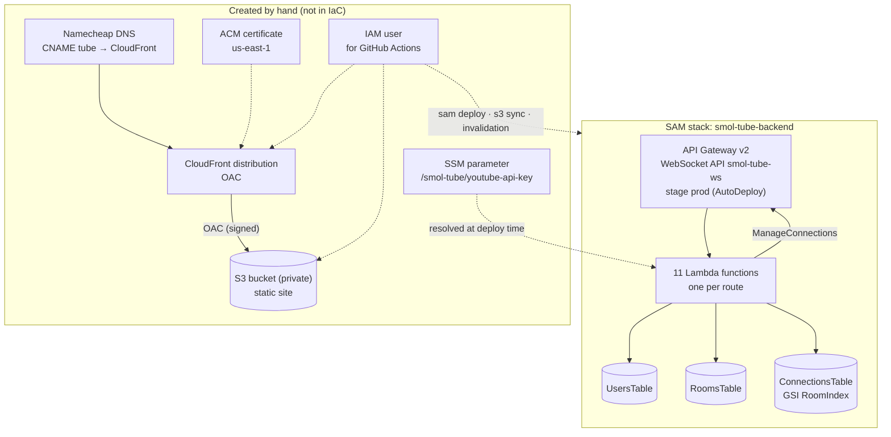

# Infrastructure

Everything runs in one AWS account, in `us-west-2` except the CloudFront certificate (`us-east-1`). The backend is a single AWS SAM stack, [`template.yml`](../template.yml), deployed as `smol-tube-backend` ([`samconfig.toml`](../samconfig.toml)). The frontend hosting, DNS and a few supporting pieces were created by hand and aren't in IaC yet.

## SAM stack

### WebSocket API

| Setting                    | Value                  | Notes                                                                       |
| -------------------------- | ---------------------- | --------------------------------------------------------------------------- |
| Protocol                   | `WEBSOCKET`            | API Gateway v2                                                              |
| `RouteSelectionExpression` | `$request.body.action` | The client's `{ "action": ... }` field picks the route                      |
| Stage                      | `prod`, `AutoDeploy`   | Route changes go live without a separate deployment resource                |
| Integrations               | `AWS_PROXY` to Lambda  | One integration, route and `AWS::Lambda::Permission` per function           |
| `$default` route           | none                   | A message whose `action` has no route doesn't reach any Lambda              |
| Authorizer                 | none                   | `$connect` accepts every connection (see [Status](../README.md#status))     |
| Output                     | `WebSocketURI`         | `wss://{api-id}.execute-api.us-west-2.amazonaws.com/prod`, for the frontend |

API Gateway WebSocket limits shape the design: a connection lasts at most 2 hours (10 minutes when idle), and a custom route's return value is not sent back to the client. That's why every result reaches the client as a broadcast ([architecture](architecture.md#request-lifecycle-aws)).

### Lambda functions

All functions share the `Globals` block:

| Setting      | Value                                                                                                |
| ------------ | ---------------------------------------------------------------------------------------------------- |
| Runtime      | `nodejs20.x` (past end of life; needs an upgrade)                                                    |
| Architecture | `x86_64`                                                                                             |
| Memory       | 256 MB                                                                                               |
| Timeout      | 5 s                                                                                                  |
| Environment  | `USERS_TABLE`, `ROOMS_TABLE`, `CONNECTIONS_TABLE`, `API_GW_ENDPOINT` (the `https://` management URL) |

| Route             | Function                  | DynamoDB access (`DynamoDBCrudPolicy`) | `execute-api:ManageConnections` |
| ----------------- | ------------------------- | -------------------------------------- | :-----------------------------: |
| `$connect`        | `ConnectFunction`         | none (just returns 200)                |                                 |
| `$disconnect`     | `DisconnectFunction`      | Connections, Rooms                     |               ✅                |
| `joinRoom`        | `JoinRoomFunction`        | Users, Connections, Rooms              |               ✅                |
| `chatMsg`         | `ChatMsgFunction`         | Users, Connections, Rooms              |               ✅                |
| `mediaUpdate`     | `MediaUpdateFunction`     | Users, Connections, Rooms              |               ✅                |
| `becomeLeader`    | `BecomeLeaderFunction`    | Users, Connections, Rooms              |               ✅                |
| `playlistAdd`     | `PlaylistAddFunction`     | Users, Connections, Rooms              |               ✅                |
| `playlistRemove`  | `PlaylistRemoveFunction`  | Users, Connections, Rooms              |               ✅                |
| `playlistReorder` | `PlaylistReorderFunction` | Users, Connections, Rooms              |               ✅                |
| `playlistPlay`    | `PlaylistPlayFunction`    | Users, Connections, Rooms              |               ✅                |
| `transitionNext`  | `TransitionNextFunction`  | Users, Connections, Rooms              |               ✅                |

`DynamoDBCrudPolicy` grants read, write and delete on the table, even where a handler only reads. Splitting routes into functions makes per-function permissions possible, but today most functions share the same policy set. Least privilege is on the [roadmap](../README.md#known-limitations-and-roadmap).

`ManageConnections` is scoped to this API (`arn:aws:execute-api:{region}:{account}:{api-id}/*/*`). The `AWS::Lambda::Permission` resources allow the `apigateway.amazonaws.com` principal without a `SourceArn`. Adding one would restrict invocation to this specific API.

### Packaging

SAM doesn't build the TypeScript. [`packages/backend/scripts/build.ts`](../packages/backend/scripts/build.ts) runs esbuild once per handler before `sam build`:

- `bundle: true` inlines `@smol-tube/domain` and the repositories, so each handler is one self-contained `.js` file.
- `@aws-sdk/*` stays external, because the Node.js Lambda runtime already ships the AWS SDK v3.
- The output is minified, targets `es2020`, and goes to `packages/backend/dist/`.

Every function uses `CodeUri: packages/backend/dist/` and selects its file through `Handler: <name>.handler`. As a result, each function's package contains all eleven bundles, even though it only runs one.

### DynamoDB

Three on-demand (`PAY_PER_REQUEST`) tables with a string partition key and TTL enabled on `expiresAt`. Nothing sets `expiresAt` yet. The table layout and the reason a room is a single item are in [architecture](architecture.md#storage-dynamodb).

The physical table names are generated by CloudFormation (`smol-tube-backend-UsersTable-XXXX`) and reach the code only through environment variables.

### Secrets

The YouTube Data API key lives in SSM Parameter Store as `/smol-tube/youtube-api-key`. Only `PlaylistAddFunction` gets it, as `YOUTUBE_API_KEY: "{{resolve:ssm:/smol-tube/youtube-api-key}}"`.

That dynamic reference is resolved **by CloudFormation at deploy time**:

- The function needs no SSM permission at runtime.
- The key ends up in plain text in the function's environment, visible to anyone who can read the function configuration.
- Rotating the key requires a redeploy.

`{{resolve:ssm:...}}` doesn't support `SecureString` parameters in Lambda environment variables. The usual alternatives are reading a `SecureString` (or a Secrets Manager secret) at cold start, or the Parameters and Secrets Lambda extension.

## Frontend hosting

The Astro build is served from a **private** S3 bucket through CloudFront:

- **Origin Access Control (OAC).** CloudFront reads from the bucket's REST endpoint (`<bucket>.s3.<region>.amazonaws.com`), not from the public static-website endpoint.
- **No public access to the bucket.** Block Public Access is on. The bucket policy allows `s3:GetObject` only to the `cloudfront.amazonaws.com` principal, with an `AWS:SourceArn` condition on this distribution, so every request has to go through CloudFront.
- **HTTPS.** The certificate for `tube.smol-ivan.xyz` comes from ACM in `us-east-1`, the only region CloudFront takes certificates from.
- **DNS outside AWS.** `smol-ivan.xyz` is managed in Namecheap, not Route 53. It holds the ACM validation CNAME records, which also let ACM renew the certificate automatically, and a `tube` CNAME pointing to the distribution's `*.cloudfront.net` domain.

The WebSocket API has no custom domain: the frontend connects to the default `execute-api` URL.

## Created by hand

These were set up by hand while learning AWS and aren't described anywhere in the repo yet:

| Resource                                      | Used by                                               | Referenced in the repo as                                   |
| --------------------------------------------- | ----------------------------------------------------- | ----------------------------------------------------------- |
| S3 bucket (private, Block Public Access)      | `deploy-frontend.yml` (`aws s3 sync --delete`)        | Bucket name hardcoded in the workflow                       |
| CloudFront distribution + OAC + bucket policy | Serves the site; invalidated on every frontend deploy | Distribution ID hardcoded in the workflow                   |
| ACM certificate (`us-east-1`)                 | HTTPS on CloudFront for `tube.smol-ivan.xyz`          | —                                                           |
| Namecheap DNS records                         | ACM validation CNAMEs; `tube` CNAME to CloudFront     | —                                                           |
| SSM parameter                                 | `PlaylistAddFunction` through the dynamic reference   | `/smol-tube/youtube-api-key` in `template.yml`              |
| IAM user + access keys                        | Both deploy workflows                                 | GitHub secrets `AWS_ACCESS_KEY_ID`, `AWS_SECRET_ACCESS_KEY` |
| SAM artifacts bucket (managed)                | `sam deploy` uploads the packaged code here           | `resolve_s3 = true` (created by the SAM CLI, not by hand)   |

<!-- TODO: document the IAM user's attached policies (needs CloudFormation, Lambda, API Gateway, DynamoDB, IAM role creation for CAPABILITY_IAM, S3 and CloudFront invalidation at minimum). -->

The roadmap's "everything as code" step means moving all of these into IaC: the bucket, the distribution with its OAC and certificate, and an IAM role for GitHub Actions trusted through OIDC instead of the long-lived user keys. DNS can stay in Namecheap, with the records documented, or move to Route 53 so it can be managed as code too.

## Cost profile

Every billed component is pay-per-use: API Gateway per message and connection minute, Lambda per invocation and duration, and DynamoDB on-demand per request. With nobody in a room, the stack has no running compute. The largest variable cost while a video plays is the leader heartbeat: one Lambda invocation, one room write and one message per connected client every 5 s ([playback sync](playback-sync.md#known-gaps)).
