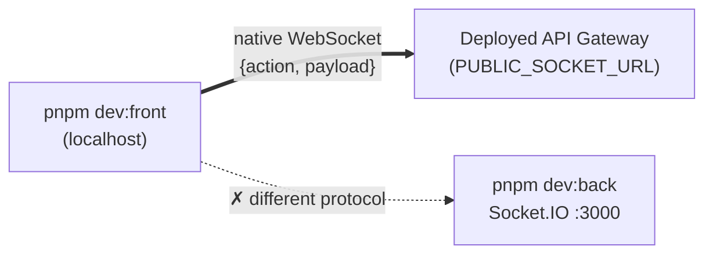
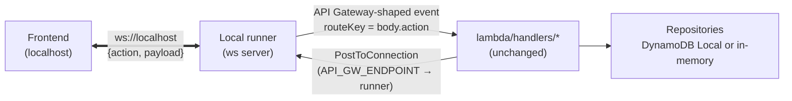

# Local development

## Environment

### With Nix (NixOS or any machine with flakes)

[`flake.nix`](../flake.nix) defines a dev shell with Node.js 24 and pnpm. [`.envrc`](../.envrc) contains `use flake`, so with [direnv](https://direnv.net/) the shell loads when you `cd` into the repo:

```sh
direnv allow     # once
# or, without direnv:
nix develop
```

`flake.lock` pins the nixpkgs revision. direnv's cache (`.direnv/`) is git-ignored.

### Without Nix

Use Node.js ≥ 22.12 (the frontend's `engines` minimum) and pnpm 10. `packageManager` in the root `package.json` pins `pnpm@10.28.1`, so `corepack enable` picks the right version.

### Install and configure

```sh
pnpm install
cp .env.example .env
ln -s ../../.env packages/frontend/.env   # Vite only reads .env from the frontend package
```

| Variable            | Read by                       | Purpose                                                                              |
| ------------------- | ----------------------------- | ------------------------------------------------------------------------------------ |
| `PORT`              | Socket.IO server              | Port to listen on (default 3000)                                                     |
| `SEED_USERS_JSON`   | Socket.IO server              | Accounts created on startup: `[{displayName, password, role}]`                       |
| `YOUTUBE_API_KEY`   | `playlistAdd` (both adapters) | Video metadata. In AWS it comes from SSM instead                                     |
| `USERS_TABLE`, ...  | Lambda repositories           | Table names, only needed to run handler code against real tables                     |
| `PUBLIC_SOCKET_URL` | Frontend (build time)         | The WebSocket URL the browser connects to: the `WebSocketURI` output of `sam deploy` |

`.env` is git-ignored.

## Everyday commands

| Command             | What it does                                                |
| ------------------- | ----------------------------------------------------------- |
| `pnpm dev:front`    | Astro dev server with hot reload                            |
| `pnpm dev:back`     | Socket.IO server on `:3000`, in-memory state, `GET /health` |
| `pnpm lint`         | Prettier `--check` (root and packages) + typecheck          |
| `pnpm format:write` | Format everything                                           |
| `pnpm test`         | Domain unit tests (Vitest) + `astro check`                  |
| `pnpm build`        | Astro static build + one esbuild bundle per Lambda          |
| `pnpm ci`           | `lint`, `test` and `build`, the same as the PR workflow     |

For a fast loop on the business rules, run Vitest in watch mode: `pnpm --filter @smol-tube/domain exec vitest`.

## What works locally today



- **The domain** is fully testable locally: the rules are pure functions.
- **The frontend** runs locally, but it talks to the **deployed** backend. Since the frontend switched to a native WebSocket client to work with API Gateway, it no longer speaks the Socket.IO protocol.
- **The Socket.IO server** still starts and runs the domain with in-memory repositories (one room, `main`, plus the seeded accounts), but no current client connects to it.
- **`sam local`** can invoke a single Lambda with a hand-written event, but it doesn't emulate API Gateway WebSocket APIs, so it can't run the app end to end.

In practice, backend changes are tested by deploying them.

## Planned: a local runner for the Lambda handlers

The roadmap replaces the Socket.IO server with a small Node server that runs **the same Lambda handlers** that AWS runs. Then there's one adapter for both environments, and anything built locally behaves the same once deployed.



The sketch, which isn't implemented yet:

1. A `ws` server accepts connections, gives each one a `connectionId`, and calls the `connect` handler. On close, it calls `disconnect`.
2. For each message, it reads `action` from the JSON body, the same way the `RouteSelectionExpression` does. It builds an `APIGatewayProxyWebsocketEventV2` (`requestContext.connectionId`, `routeKey`, `body`) and calls the matching handler.
3. Broadcasts go through the API Gateway Management API client. Pointing `API_GW_ENDPOINT` at the runner, with a small `POST /@connections/{id}` endpoint, delivers them to the right local socket without changing handler code.
4. For storage, `lambda/state.ts` either points at [DynamoDB Local](https://docs.aws.amazon.com/amazondynamodb/latest/developerguide/DynamoDBLocal.html), which keeps the real Dynamo repositories in the loop, or selects the in-memory repositories.

Once the runner can do everything the Socket.IO adapter does, the Socket.IO server and its handlers can be deleted. Features that exist only there (moderation, roles, skip votes) need Lambda handlers first.
