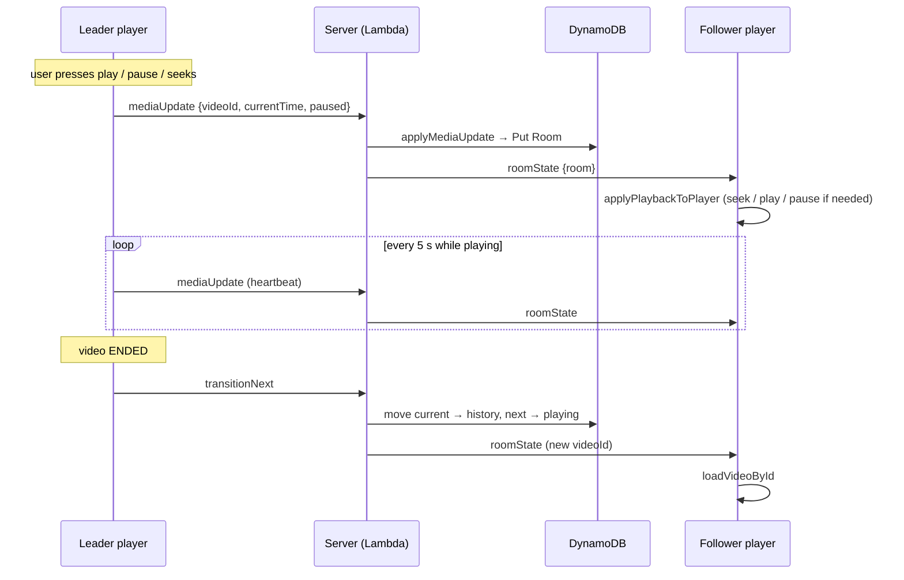

# Playback sync

How everyone in a room ends up watching the same moment of the same video.

## Model: a single leader

Like CyTube, each room has **one leader** (`room.playback.leaderUserId`). Only the leader's player is the source of truth; everyone else follows the leader.

- Anyone with `playback:becomeLeader` who isn't banned can take the lead by clicking the sync button. There's no handoff confirmation: the newest claim wins.
- When the leader disconnects, `$disconnect` clears `leaderUserId`.
- The domain rejects a `mediaUpdate` that doesn't come from the leader, or whose `videoId` isn't the current one, so a stale update from the previous video can't rewind the room.

The server never runs a clock. It stores the last state the leader reported and relays it to the room.

## Leader side ([`ui/player.ts`](../packages/frontend/src/scripts/ui/player.ts))

- The leader's player emits `mediaUpdate` on YouTube's `PLAYING` and `PAUSED` state changes.
- It also sends a heartbeat every 5 s while playing (`startContinuousSync`). The time is floored to whole seconds.
- On `ENDED`, the leader emits `transitionNext`, so the queue advances on its own.
- Only the leader's player is created with YouTube controls (`controls: 1`). Followers get `controls: 0`, and the player is recreated whenever the user gains or loses the lead.

## Follower side

Every `roomState` goes through `applyRemoteRoom`, which renders the queue and calls `applyPlaybackToPlayer`:

| Situation                           | Action                                    |
| ----------------------------------- | ----------------------------------------- |
| Different video from the one loaded | `loadVideoById(videoId, time)`            |
| This client is the leader           | Ignore (the leader never corrects itself) |
| Play/pause state differs            | Seek if drift > 2 s, then play or pause   |
| Same state, drift > 15 s            | Seek to the leader's time                 |
| Same state, drift ≤ 15 s            | Do nothing                                |

The 15 s threshold is deliberately loose. A heartbeat carries the time the leader had when it sent it, so a follower always looks slightly "ahead". With a tight threshold, followers would stutter on every heartbeat.

## What made the YouTube IFrame API hard

These are the bugs that shaped `player.ts` (each one is documented inline as a `FIX` comment):

1. **Calling the player before it's ready.** `new YT.Player()` returns at once, but the player only accepts commands after `onReady`. Calls made before that, such as the leader adding a video while the iframe was still loading, failed silently. Fix: keep the latest requested state in `pendingApply` and apply it inside `onReady`.
2. **The mount node disappears.** `YT.Player(element)` _replaces_ the element with its iframe, and `destroy()` removes that iframe. Recreating the player on a leader change used a stale, detached reference and gave a black screen. Fix: a stable anchor `
` that YouTube never touches, plus a throwaway child that gets mounted again on each recreation.
3. **Echo loops.** Applying a remote state triggers `onStateChange`, which would look like a local action and get sent back out. Fix: a `suppressEmit` flag is held for 200 ms after applying remote state, and non-leaders never emit.

## Known gaps

- **Guest leaders can't actually sync.** Guests may become leader (`playback:becomeLeader`), but `applyMediaUpdate` also requires `playback:control`, which only moderators and admins have. In production, where everyone is a guest except the hardcoded admin, a guest leader's play, pause and seek are rejected.
- **No latency compensation.** Followers seek to the leader's reported time without adding transit time or using server timestamps.
- **Heartbeat cost in AWS.** Every heartbeat writes the room and broadcasts to everyone. The Socket.IO adapter only broadcasts real changes: play/pause, a video change, or a seek of more than 15 s. Moving that filter into the domain would let both adapters share it.
- **Rejected updates are silent.** The client acknowledges every action as successful after 150 ms, whatever the server decided.
